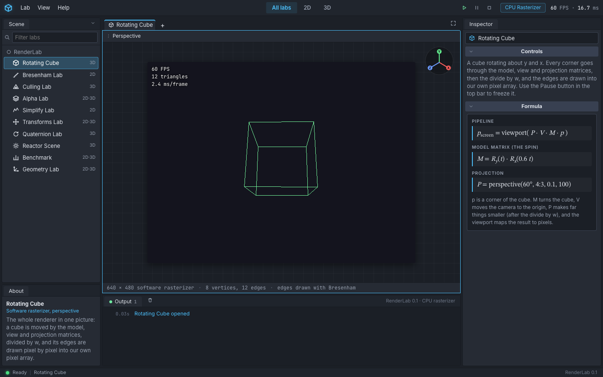
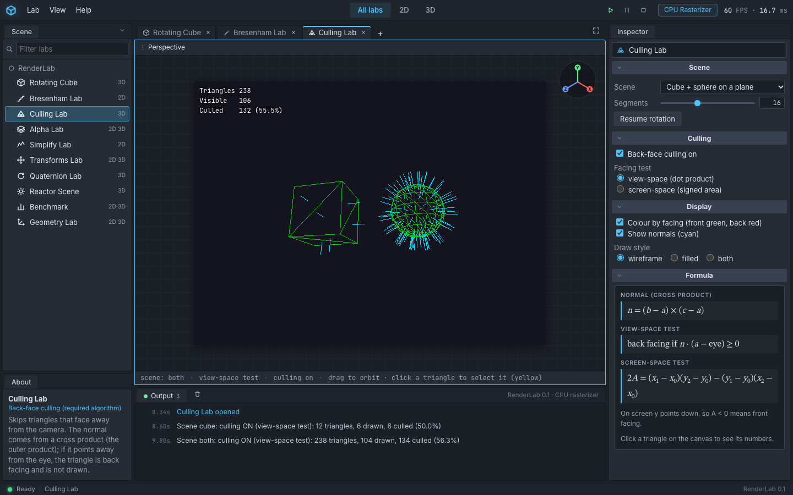
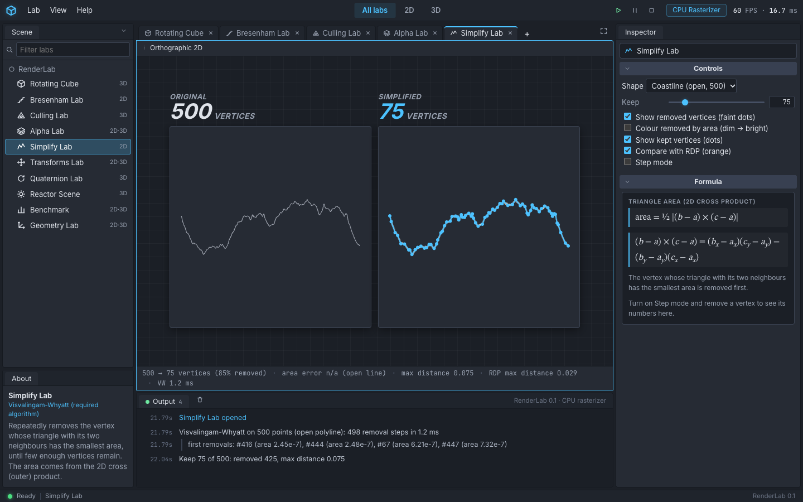
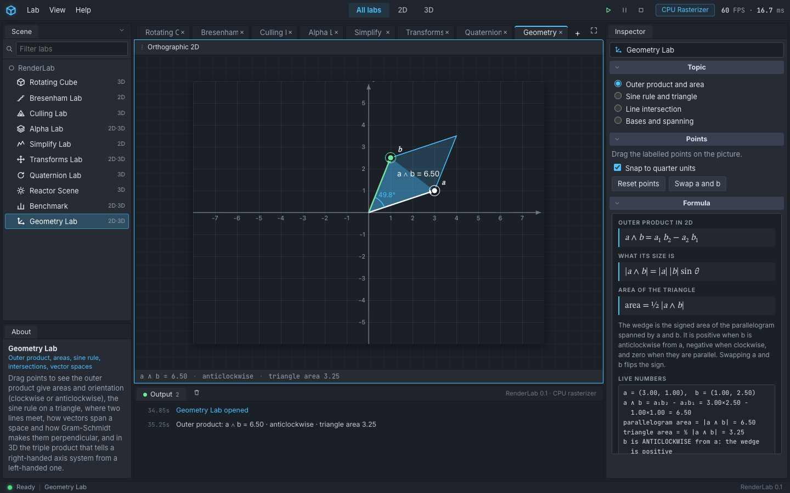
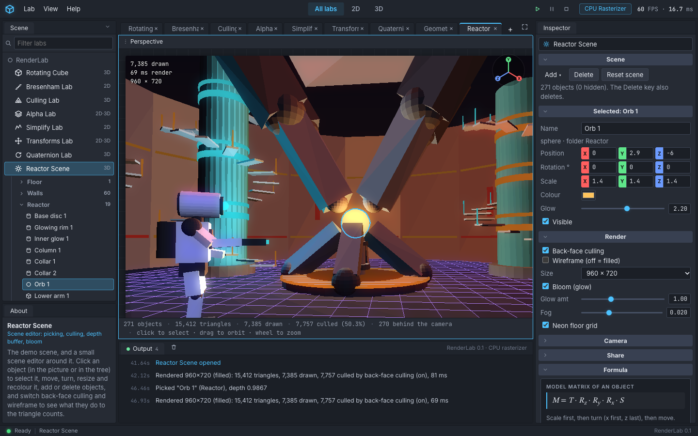

# RenderLab

RenderLab is a computer graphics laboratory that runs in the browser. Everything on screen is drawn by our own code: a software rasterizer that writes pixels into a `Uint8ClampedArray` and shows it on a canvas. There is no WebGL and no Three.js. Each lab takes one topic from the course *Geometric Algebra for Computer Graphics* (22B12MA412, Jaypee Institute of Information Technology, Noida) and lets you drag, click and step through it, with the formulas and the live numbers next to the picture.

The project was made by Yasharth Singh (9923103059) and Rakshit Suneja (9923102028) for Semester VII, session 2026-2027.



The window is laid out like a small game engine editor. The left side lists the labs (Scene dock) with a short description under it (About dock). The middle holds the viewport, the open-lab tabs and the Output dock, which prints a trace of what the algorithm is doing. The right side is the Inspector with the controls and the typeset formulas.

## The four required algorithms

All four are written by hand, with no graphics or maths library. The algorithm code is plain TypeScript in `src/core/` with no React or browser imports, and every one of them has tests.

| Algorithm | Where the code is | Lab that shows it |
|---|---|---|
| Alpha compositing (Porter-Duff "over") | `src/core/render/alpha.ts` (`over`, premultiplied version, `compositeLayers`), `Framebuffer.blendPixel` in `framebuffer.ts`, the see-through pass in `transparent.ts` and `fill.ts` | Alpha Lab |
| Back-face culling | `src/core/render/culling.ts` (`triangleNormal`, `isBackFacingView`, `isBackFacingScreen`, `cullTriangles`), used by `renderMesh.ts` and `scene.ts` | Culling Lab, Reactor Scene |
| Bresenham line drawing | `src/core/render/line.ts` (`bresenhamSteps`, `drawLine`), with the old DDA in `dda.ts` for comparison | Bresenham Lab |
| Visvalingam-Whyatt simplification | `src/core/simplify/visvalingam.ts`, with Ramer-Douglas-Peucker in `rdp.ts` for comparison | Simplify Lab |





## The other syllabus topics

| Topic | Lab |
|---|---|
| 2D and 3D transformations (translate, rotate, scale, shear, reflect) | Transforms Lab |
| Rotation about an arbitrary point and an arbitrary axis | Transforms Lab |
| Determinants of rotation, shear, reflection and scaling; area and volume change | Transforms Lab |
| Quaternions against Euler angles, gimbal lock, slerp against lerp | Quaternion Lab |
| Outer product: area of a parallelogram and of a triangle, orientation | Geometry Lab (mode 1), Culling Lab |
| Normals from the cross product | Culling Lab |
| Clockwise and anticlockwise | Geometry Lab (mode 1), Culling Lab (screen-space test) |
| Sine rule | Geometry Lab (mode 2) |
| Intersection of two lines | Geometry Lab (mode 3) |
| Vector spaces, spanning sets, orthogonal bases (Gram-Schmidt), coordinates in a basis | Geometry Lab (mode 4, plane) |
| Left-handed and right-handed axis systems, the triple product, volume | Geometry Lab (mode 4, space) |



Two labs are extras outside the four graded algorithms. **Reactor Scene** is a demo scene with a small scene editor (select, move, rotate, scale, recolour, add, delete). Its lighting, fog and bloom are extras. **Benchmark** times the project's own code and exports the numbers as CSV or markdown.



## How to run it

You need Node.js (version 20 or newer) and npm.

```bash
npm install
npm run dev
```

Open the address that `npm run dev` prints (usually http://localhost:5173). To run the tests and the type check:

```bash
npm test
npx tsc --noEmit
```

To make a production build:

```bash
npm run build
npm run preview
```

## Folder layout

```
src/
  core/                pure TypeScript, no React or DOM imports; every file has tests
    math/              vec3, mat3, mat4, quat, and the helpers of the Transforms,
                       Quaternion and Geometry labs
    render/            framebuffer, camera, Bresenham, culling, alpha, triangle fill,
                       meshes, lighting, bloom, the reactor scene and the scene editor logic
    simplify/          Visvalingam-Whyatt, RDP, the sample shapes, error metrics
    bench/             timing tools and the five benchmark suites
  ui/                  React: one file per lab, plus
    components/        shared pieces (layout, typeset equations, number rows, inspector parts)
    shell/             the editor window (menus, Scene tree, tabs, Output dock, status bar)
docs/QA.md             the QA click-through table
report/                the LaTeX report (main.tex, chapters/), figures/ and data/
```

## Tests

`npm test` runs 487 tests in 31 files with Vitest. They cover the maths (159), the renderer and the scene editor (229), line simplification (54), the benchmark tools (36) and the formula parser (9). Details are in the report and in `docs/QA.md`.

## Notes and limits

- Triangles with a corner behind the camera are skipped, not clipped.
- Shading is flat (one colour per triangle). Planes are one-sided.
- Visvalingam-Whyatt rescans all points for every removal, so it is O(n²). A heap would make it O(n log n).
- Benchmark numbers depend on the computer and the browser. The Benchmark tab shows the machine details and the report states the conditions it was run under.
